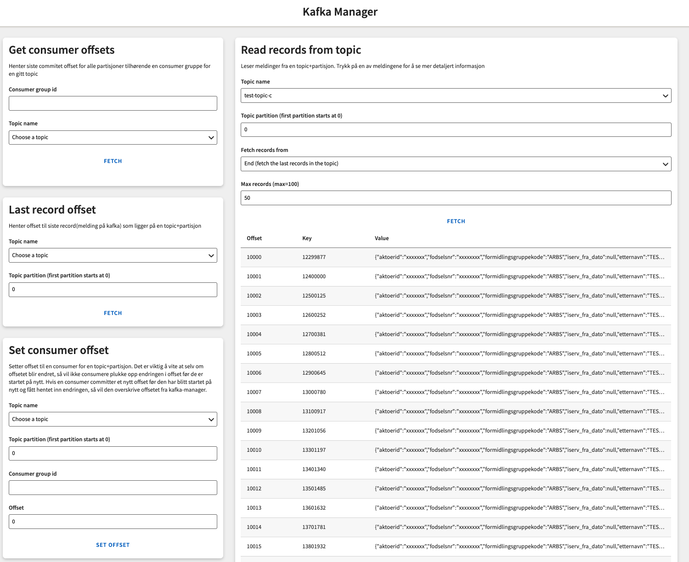
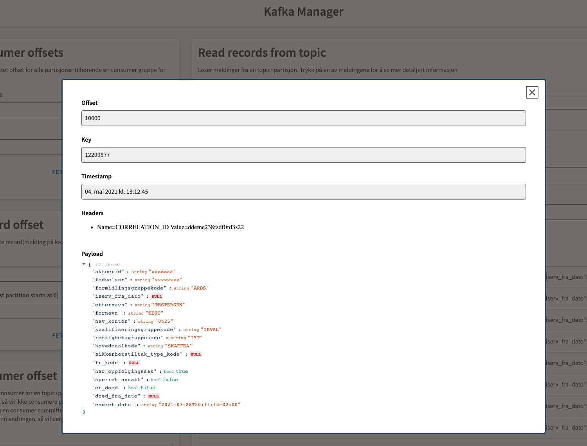

# Kafka Manager

Kafka Manager lar deg lese meldinger fra Kafka-topics, vise consumer offsets og endre eller slette meldinger.

Appen støtter både on-prem Kafka og Aiven Kafka, og viser de fleste meldingstyper.

## Innhold

- [Skjermbilder](#skjermbilder)
- [Bygg og test lokalt](#bygg-og-test-lokalt)
- [Deploy](#deploy)
- [Autorisering](#autorisering)
- [Deserialisering](#deserialisering)
- [Tilgang til topics](#tilgang-til-topics)
- [Image repository](#image-repository)
- [Sikkerhet](#sikkerhet)
- [Status](#status)

## Skjermbilder





## Bygg og test lokalt

Åpne repoet som et Gradle-prosjekt i IntelliJ IDEA, eller kjør kommandoene fra repo-roten. Bygget bruker Java 25. Gradle laster ned riktig Node.js-versjon for frontend-byggingen.

```shell
./gradlew build
./gradlew check
```

Frontend-pakker fra GitHub Packages krever lesetilgang. Legg `//npm.pkg.github.com/:_authToken=${NODE_AUTH_TOKEN}` i `~/.npmrc`, og sett `NODE_AUTH_TOKEN` før du bygger.

Gradle installerer pnpm med npm. Godkjenn installasjonsskriptene til pnpm med:

```shell
npm config set allow-scripts=pnpm --location=user
```

## Deploy

Hvert team må deploye sin egen instans i sitt team namespace. Erstatt plassholderne i malen med egne verdier, og lagre manifestet som `team-kafka-manager.yaml`. Deploy det med:

```shell
kubectl apply -f team-kafka-manager.yaml
```

```yaml
kind: Application
apiVersion: nais.io/v1alpha1
metadata:
  name: <team>-kafka-manager
  namespace: <team>
  labels:
    team: <team>
spec:
  image: europe-north1-docker.pkg.dev/nais-management-233d/poao/kafka-manager:<version> # See https://console.cloud.google.com/artifacts/docker/nais-management-233d/europe-north1/poao/kafka-manager
  port: 8080
  webproxy: true
  ingresses:
    - https://<team>-kafka-manager(.dev).intern.nav.no
  prometheus:
    enabled: true
    path: /internal/prometheus
  readiness:
    path: /internal/health/readiness
    initialDelay: 20
  liveness:
    path: /internal/health/liveness
    initialDelay: 20
  replicas:
    min: 1
    max: 1  # Keep one replica because sessions are stored in memory
    cpuThresholdPercentage: 75
  resources:
    limits:
      cpu: "1"
      memory: 1024Mi
    requests:
      cpu: 250m
      memory: 512Mi
  vault:   # Optional. Required for on-prem. Alternatively, set SERVICE_USER_NAME and SERVICE_USER_PASSWORD.
    enabled: true
    paths:
      - kvPath: /serviceuser/data/<dev|prod>/srv<team>-kafka-manager
        mountPath: /var/run/secrets/nais.io/service_user
  azure: # Required
    application:
      enabled: true
      tenant: nav.no
      claims:
        groups:
          - id: <Azure AD group> # Required for authorization
  kafka: # Optional. Required for Aiven
    pool: nav-<dev|prod>
  env:
    - name: ON_PREM_KAFKA_BROKERS_URL # Optional. Required for on-prem
      value: <BROKER URL>
    - name: ON_PREM_SCHEMA_REGISTRY_URL # Optional. Required for on-prem topics that use Avro
      value: <SCHEMA REGISTRY URL>
    - name: APP_CONFIG_JSON # Required
      value: >
          {
            "topics": [
              {
                "name": "topic-a",
                "location": "ON_PREM",
                "keyDeserializerType": "STRING",
                "valueDeserializerType": "STRING"
              },
              {
                "name": "<some team>.topic-b",
                "location": "AIVEN",
                "keyDeserializerType": "STRING",
                "valueDeserializerType": "STRING"
              },
              {
                "name": "topic-c",
                "location": "ON_PREM",
                "keyDeserializerType": "LONG",
                "valueDeserializerType": "AVRO"
              }
            ]
          }
```

### Autorisering
Kafka Manager bruker gruppene i `spec.azure.application.claims.groups` til å styre hvem som får tilgang. Oppgi ID-en til en Azure AD-gruppe som bare inneholder brukere som skal ha tilgang.

Se [NAIS-dokumentasjonen om gruppetilgang i Entra ID](https://doc.nais.io/auth/entra-id/how-to/secure/#groups).

### Deserialisering

Disse typene støttes i `keyDeserializerType` og `valueDeserializerType`:

```text
STRING
DOUBLE
FLOAT
INTEGER
LONG
SHORT
UUID
AVRO
```

### Tilgang til topics

Gi Kafka Manager tilgang til alle topicene i `APP_CONFIG_JSON`.

For on-prem legger du til systembrukeren som consumer med oneshot-endepunktet, for eksempel:
```json
"members": [
    {
      "member": "srv<team>-kafka-manager",
      "role": "CONSUMER"
    }
]
```

For Aiven legger du til applikasjonen med `read`-tilgang på topicet, for eksempel:
```yaml
spec:
  acl:
    - team: <team>
      application: <team>-kafka-manager
      access: read
```

## Image repository

Kafka Manager-images publiseres i Google Artifact Registry:

- [Kafka Manager](https://console.cloud.google.com/artifacts/docker/nais-management-233d/europe-north1/poao/kafka-manager)
- [Kafka Manager med `-temp`-suffiks](https://console.cloud.google.com/artifacts/docker/nais-management-233d/europe-north1/poao/kafka-manager-temp)

Se [NAIS-dokumentasjonen om image repository](https://doc.nais.io/workloads/explanations/imagerepository/) for informasjon om image repositories på Nais.

## Sikkerhet

Teamet må vurdere hvilke topics som kan vises i grensesnittet, og hvem som skal ha tilgang til dem.

## Status

Kafka Manager ble utviklet som en POC. Det kan være mangler i både kode og funksjonalitet. Bruk på eget ansvar.
